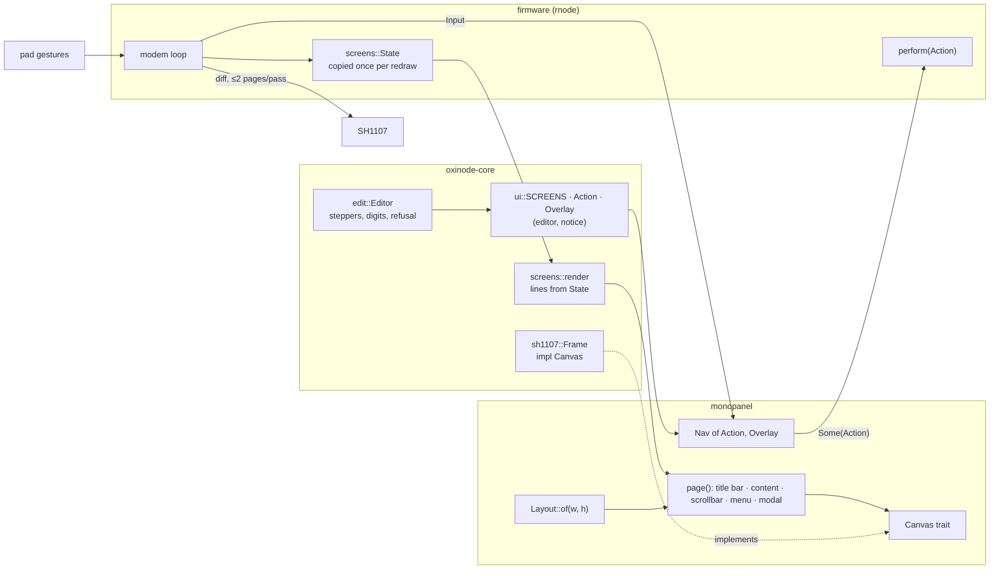

# The interface

Everything the panel shows is drawn by `monopanel`, a workspace crate under
`panel/` with nothing of oxinode in it. oxinode's own screens, menus, actions
and editor live in `oxinode-core` and consume the crate through its public
interface and no other way; the firmware supplies the values and carries out
the actions. The same render path runs on the board and in the simulator,
which is what makes every screen a host test and a golden image.

## `monopanel`

Five modules, no dependencies, `no_std`, `forbid(unsafe_code)`:

- **`canvas`**: the `Canvas` trait (width, height, set a pixel, with `fill`,
  `rect` and `frame_rect` provided on top so a canvas with a faster fill
  overrides one method) and `Readable`, a second smaller trait for tests and
  simulators, since plenty of displays cannot read a pixel back and none of
  the drawing needs to. `Bitmap` is a canvas of any size for tests.
- **`layout`**: `Layout::of(width, height)`, `const`. The bars are as tall as
  what they hold (the font and the icons) and the content gets what is left,
  so a shorter panel loses lines and nothing else and a narrower one loses
  characters. A test pins the 128 × 128 layout to the numbers the interface
  was first drawn with.
- **`nav`**: `Input`, `Item`, `Screen`, `Modal`, `Outcome`, `NoModal`,
  `Detail`, `NoDetail`, and `Nav<A, M, D>`. Screens are data the application
  supplies, a slice of descriptors (title, menu title, icon, menu, and
  `open` for a list), and the navigator is generic over the action type its
  menu items carry. It hands an action back from `handle` when the user
  picks one and never interprets it.
- **`draw`**: the title bar, the icon strip, the menu (windowed around its
  highlight when it does not fit), the scrollbar, and `page`, which composes
  them. `page_of` takes the content as a `Content`: every line, a list with
  nothing in it yet, or a window onto content too long to hold, whose total
  the scrollbar is drawn from.
- **`font`**: the 5 × 7 font.

And one optional module, `eg`, behind the `embedded-graphics` feature, which
goes both ways round: `Target` makes any `Canvas` a `DrawTarget`, so the
ecosystem's primitives can be drawn onto a frame this interface owns, and
`Display` makes any monochrome `DrawTarget` a `Canvas`, so the interface can
be drawn onto any of the display drivers that speak `embedded-graphics`. A
`Canvas` cannot fail and a `DrawTarget` can, so `Display` keeps the last
error for its owner to look at rather than turning every `set_pixel` into a
`Result`. Both directions are tested, the second against
`embedded-graphics`'s own `MockDisplay`.

The crate has a README and a doctest showing a two-screen application in
thirty lines. It is `publish = false` under a name that is free on crates.io,
waiting for a second device.

## Three levels, and two exceptions

1. **Screens**, side by side, moved between with left and right. Content is a
   list of text lines the application formats into its own buffers; `page`
   draws the ones that fit from the scroll position with a scrollbar when
   there are more. A screen whose descriptor has `open` set is a **list**:
   each line is an entry, up and down move a highlight drawn as a bar with
   the text knocked out of it (the view follows it, and it stops at the
   ends), and OK hands back the `open` action for the caller to act on
   `Nav::selected`. A list has no menu, which `Nav::new` asserts, and with
   no entries it is an ordinary screen.
2. **A menu** over each screen, opened with OK. Each item carries an action of
   the application's type, or `None` for an item that only closes the menu.
3. **A modal**, opened by the caller and not by a menu, that takes every key
   until it is done and keeps the screen's scroll under it. The navigator
   returns `Action::Edit(field)` from the menu, and the caller answers with
   `Nav::edit` or `Nav::notice`, because opening an editor needs the
   configuration to edit and only the caller knows whether a host has the
   line. The firmware's `perform` does it in six lines; the simulator's
   `Scene::press` does it in the same six.
4. **A detail**, the other exception: opened by the caller over a screen,
   browsed like one. It has its own title, scroll and menu (OK opens it);
   up and down scroll it by line, left and right move it by whatever the
   application says its parts are (`Detail::step`, clamped by the
   navigator), and back closes it and puts the screen under it back as it
   was, scroll and highlight. The strip keeps marking the screen it was
   opened from. A menu or a modal can be opened over it. A modal does not
   scroll; a detail is what something longer than a screen is.

## What oxinode supplies

**Screens** (`core/src/ui.rs`): the five descriptors (seven with the node,
which adds Messages and Peers after Home), oxinode's `Action`
enum, `Overlay`, its `Modal`, which is the editor or the notice, and
`Conversation`, its `Detail`, the thread with one peer. A `NavExt` trait adds
the things oxinode asks of the navigator beyond what the crate provides:
the current screen as the enum, and the overlays and the conversation by
name.

**Content** (`core/src/screens.rs`): what each screen is allowed to know. It
is handed a `State`, a small struct per screen of plain values, and formats and
draws it. No protocol, no clock, no pin. The firmware copies the values out of
the modem loop once per redraw in one function; the simulator hands over a
fixture. A field that is not known is an `Option`, and `None` draws as a
dash; a test walks the empty state and refuses any line that ends in a number
where a dash belongs. A `label value` row is right-aligned by padding, because
the font is fixed-width and a column of values is what makes a page of
numbers readable. `Lines` records when a line was cut to fit, and every
screen, editor and notice asserts it was not.

**The editor** (`core/src/edit.rs`): an `Editor` opens on a copy of the whole
configuration and a field. Five fields are steppers over a fixed set,
saturating at the ends; a value not in the set (a bandwidth a host set) steps
onto the set in the direction pressed. Frequency is a digit editor, seven
digits of kilohertz with four before the point, with whatever the original
had below a kilohertz kept unseen; the candidate is 64 bits wide because
seven digits reach past a `u32` of hertz, and a value past it saturates to
one in neither band rather than wrapping into one. Confirming puts the
candidate into the copy and asks `ValidConfig::new`, the same function that
decides whether a host's configuration may reach the chip, for both bands; a
candidate that fails stays in the editor with the reason under it. The sets
are deliberately wider than what the radio accepts on either band (power runs
from −18 to 22 dBm, bandwidth lists the ten LoRa bandwidths a host offers and
the three of the 2.4 GHz path) so the refusal path is reachable and tested.
Cancel hands out nothing: the editor holds a copy and confirm is the only
thing that hands a value out.

**A modal does not scroll**, so the editor and the notice are written to the
rows the canvas has (`Editor::lines_in`, `Lock::lines_in`). Each line has a
priority, a wrapped sentence is one unit, and on a panel too short for all of
them the least important go first, whole: blank lines, then the word
*Refused:*, the key hints, the original value and *OK: set Back: cancel*, the
cursor. What a refused editor keeps longest is the value and the whole of the
reason it was refused, so a 128 × 64 panel's four rows show exactly those; a
notice keeps who has the radio and what to do about it. The board's own panel
has room for every line and shows them all. A test drives every editor to
every refusal it can reach at both sizes and fails if any is cut.

**The protocol's side** (`Protocol::set_from_panel` and friends): the host's
setter without the reply. The setting lands unvalidated, as a host's does, and
if the radio is on it is reprogrammed through `ValidConfig` or refused with
the reason in `last_error` and the radio off. A test drives a host and a panel
to the same impossible power and asserts the two protocols end in the same
state.

## The host-ownership rule

An RNode is host-controlled. Reticulum's `RNodeInterface` validates its
configuration exactly once, when it brings the interface up; unsolicited
parameter frames afterwards update its bookkeeping and a debug line and
nothing else; and the only frame that makes it look again is an error, which
takes the interface down and brings it back up with the host's own
configuration over the top. So "edit freely and tell the host" does not exist,
and the rule is:

> **A live session on USB or Bluetooth owns the live radio configuration.**

A live session is DTR asserted on the KISS port, or a phone connected, the
same test the Home screen's `Host` row makes. It is deliberately not "the
host has turned the radio on": `rnodeconf` holds the port open without
touching the radio, and a host in the middle of `initRadio` has the port open
and the radio still off. The stricter test is never wrong about who is in
charge; its cost is that a terminal left open on the KISS port locks the
panel, which the notice says.

The rule is one function, `Action::changes_the_radio`, applied in one place
in the firmware, and the simulator's scene applies the same function so the
golden images of the notice are the board's behaviour. What it leaves the
panel free to do under a host is what the host does not own: *Save Config*,
*Forget Phones*, the screen, and the restarts.

Persistence follows the same rule. In TNC mode a panel edit goes into the
stored configuration as well as the live one; under host control nothing is
stored, because the host sets its configuration again on every connect. The
stored configuration is the `CONF_*` bytes of the EEPROM image that
`rnodeconf --tnc` writes; the panel did not need a second home for it.

## Two modes: a host's RNode, or a node of its own

An image built with `node` is one more thing besides: with nobody on the
line it is a Reticulum node of its own, with its own identity. Which of the
two it is gets decided in `oxinode_core::mode`, and is on the Home screen as
`Mode`:

| `Mode` | When | What runs |
|---|---|---|
| `RNode` | a host has spoken, on USB or over Bluetooth | the RNode, exactly as an image without the node; the node does nothing |
| `node` | no host, and a configuration is stored | the node, on the stored configuration |
| `no radio config` | no host, and nothing stored | neither; the radio is left as the host left it |

**A host is present once it has sent a KISS frame**, not merely once the port
is open: every real host speaks at once (`RNodeInterface` sends a detect when
it opens the port, Sideband as soon as the link is up), so this costs nothing,
and it rules out a computer the board is only charging from, a terminal left
open on the port, and a bonded phone in range that has not connected. That
makes it a different test from the ownership rule above, on purpose: a silent
terminal still locks the panel's editors, which is the safe answer about who
owns the radio, but it does not stop the board being a node, which would be
the useless one. So `Host` and `Mode` can disagree, and `Host USB` with
`Mode node` means exactly that.

**A host arrives with its first frame and leaves slowly.** The node gives way
on the pass that frame arrives in. A host is gone when, on USB, the bus goes
(the cable, or the computer asleep) or DTR falls after having been up, which
is what closing the port does, and over Bluetooth when the link drops. It has
to stay gone for three seconds (`HOLD_MS`) before the board is a node again,
so a cable knocked out and pushed back, or `rnsd` restarted, finds the board
still its RNode. After that it is forgotten, and coming back means speaking
again.

**The node uses only a stored configuration.** Standalone, the radio runs on
the configuration TNC mode keeps, the one `rnodeconf --tnc` or *Save Config*
stored, and when the last host leaves the radio goes back to it, as it does at
boot, because the host may have left it on its own settings or switched it off
on its way out (`RNodeInterface` sends `CMD_LEAVE`). A board with nothing
stored has no configuration anybody chose for it to be a node on, so the node
does not run and nothing touches the radio.

### What the node sends

Its own announce, `lxmf.delivery` under the board's identity, with the name
`oxinode` and the board's four hex digits in LXMF's app data, so Sideband and
MeshChat list it by name. It goes when the node starts or resumes, every half
hour, on *Announce Now*, and in answer to a path request for the board's
address (marked as a path response, so a peer that knows only the hash finds
it). Each goes through the same transmit path as a host's packet: the stock
air header, the split at 254, carrier sense.

**A budget, before anything else.** Reticulum caps announce traffic at 2% of
an interface's time, and the board holds its own announces to the same cap:
an announce that took *t* on the air is followed by 50 *t* of quiet before
the next, whatever asks. At SF8 and 125 kHz that is 26 s, at SF12 a little
over four minutes, and at the slowest configuration the radio accepts, SF12
at 62.5 kHz and 4/8, about seventeen. The System screen shows the figure for
the configuration in force. Reasons that arrive during the quiet wait for it,
and several are one announce.

**It never sends under a host, nor when one may be about to speak.**
`RNodeInterface` opens the port, waits two seconds, sends a detect, and
gives the board a fifth of a second to answer before deciding there is no
RNode there. So the node starts a transmission only while no port is open and
no phone is linked, though it goes on listening; a transmission still waiting
for a clear channel gives up at its next sense when the port opens; and when
a host arrives whatever was queued is dropped and counted. A packet already on
the air finishes, which at SF8 is about half a second.

**The emission time is the GPS's.** An announce carries the time it was
made, and a receiver that already holds a path through another node replaces
it only with a strictly newer one. The board's only clock is its GPS receiver,
so the time is Unix seconds from it when it has said what time it is, and
zero, which Reticulum reads as not known, when it has not.

### What the node hears

Every packet the node hears is queued for the engine (`node::Inbox`, eight
deep) and the engine is handed one on a pass of the modem loop on which the
radio had nothing, because verifying an announce takes it about 45 ms and the
radio comes first. The channel cannot deliver announces faster than that for
long, so the queue bounds memory rather than speed: when it is full the
oldest packet goes, and the log counts it.

An announce the engine verified for an `lxmf.delivery` address becomes a peer
(`node::peers`), or brings one up to date: its key, its display name read as
LXMF reads it, when it was heard, the hops, and the signal if it came
straight off the air. The table holds sixteen and evicts the peer heard
longest ago, except one with a conversation, which is never pushed out for a
stranger; if every peer has one, the stranger is not kept, and that is
counted. Other announces (propagation nodes, NomadNet, telemetry) are
verified and passed over. A peer announcing again is heard again only if
its announce is stamped strictly later than the last, as in Python's
`Transport`. The engine's clock starts at 2^40 seconds at boot, beyond any
stamp an announce can carry, because `rns-core` otherwise takes a stamp more
than a day ahead of its clock for none, and a clock that started at zero put
every real Unix time there. The engine's own path table is its business; the
Peers screen shows what the last announce said. Everything is in RAM until a
reboot.

### What the node receives

A packet the engine delivers to the board's own `lxmf.delivery` address is a
message, if it is one LXMF sent opportunistically: a single packet, decrypted
with the board's key, read as LXMF 1.1.1 reads it (`node::lxmf`, written
here, since `rns-core` has no LXMF). On the air the destination hash is not
part of what is encrypted, because the packet is addressed to it already; it
goes back on the front to compute the message hash, and a stamp, if the
sender added one, is left out of it, as LXMF leaves it. The bytes are walked
in place rather than decoded: a sender can encrypt to anyone who has
announced, and `rns-core`'s msgpack decoder reserves room for every array it
is told about before reading it, which 400 bytes of nested headers turn into
368,544 bytes of heap on a board that has 64 KB.

What happens to it then is `node::Station::take`'s, tested from end to end
in `oxinode-core` against messages Python LXMF packed and the proof Python
Reticulum makes:

| The sender | The message | On the air |
|---|---|---|
| heard, and its key signed it | kept, verified | a delivery proof |
| heard, and its key did not sign it | not kept; logged as forged | nothing |
| not heard | kept, unverified | a delivery proof, and a path request for the sender |
| sent it before (same message hash) | not kept twice | a delivery proof for this packet |

The proof is Reticulum's implicit one: the board's signature over the
packet's hash, addressed to that hash's first sixteen bytes, which is what
the sender's receipt waits for. Reticulum proves a packet the moment it
decrypts; the board waits to know what it believes of the sender, so a
forgery is not acknowledged. The answer to a path request is the sender's
announce, which carries its key; when it comes the waiting messages are
checked and become verified, or fail for good. A retry of an unverified
message asks again. The message hashes of the last 64 messages are
remembered, so a retry is known after its message has gone from the store.

The store keeps sixteen messages. Title and text are kept; the other LXMF
fields are not, and a message with one that describes something the board
cannot show (an image, a file, audio, telemetry, anything unknown) is marked
as having an attachment. Fields that only describe the message (its icon,
thread, ticket, renderer, what it replies to) do not count. A new message
lights the panel and the Home screen's unread count.

### What the node sends a peer

A message the board writes is LXMF's opportunistic kind too
(`node::lxmf::pack`): the timestamp as a double, an empty title, the text as
bytes and no fields, signed once by the board's key, and encrypted to the
recipient's key afresh for every attempt, as LXMF encrypts a retry. The
engine routes each attempt, so a peer heard through a transport node is sent
to through it, with the second address in the header. One packet carries 383
bytes encrypted, which is 287 bytes of text: a little under LXMF's own 295,
which is sized for a packet with one address and overflows the MTU with two.
Longer is refused, never cut. The timestamp is the GPS's time; with no fix,
the newest time a message arrived stamped with, run on since; with neither,
zero.

The outbox (`node::outbox`, eight messages) follows each one:

| State | What it is waiting for, or why it stopped | The thread says |
|---|---|---|
| queued | its turn on the channel | `queued` |
| queued | the recipient's key: its path is asked for every 20 s | `queued`, `(finding a path)` |
| queued | a host to leave, or a configuration to be stored | `queued`, `(held for the host)` or `(no radio config)` |
| sent | the recipient's proof | `sent`, then `(sent twice)`, `(sent again)` |
| delivered | nothing: a proof signed by the recipient's key came back | `delivered` |
| failed | no path within 60 s, or no proof after three attempts | `failed`, `(no path found)` or `(no proof came back)` |

The wait after an attempt is the quiet the announce budget would ask after
a packet that long, 50 times its airtime, and never less than 20 s; it
doubles after each. At the default settings (SF8, 125 kHz) a canned reply is
0.6 s on the air, so it waits about 30, 59 and 119 s, and a message to a
peer that is switched off fails three and a half minutes after it first
went; the longest message fails after eight. At SF12 it is longer in
proportion. Every attempt
waits for a clear channel like any packet the node sends. A proof is matched
to the packets of every attempt, so a late one still delivers the message,
and one signed by any key but the recipient's delivers nothing.

Encrypting takes about a tenth of a second, so an attempt is built on a
modem-loop pass when the radio is quiet, like looking at a heard packet, and
then waits behind the node's other packets. When a host arrives everything on
its way is held, and an attempt built or handed to the radio and not sent is
not counted; when the host has gone the held messages are queued again. A
message can be written under a host: it is held from the start and says so,
because writing is not taking the radio. *Retry Failed* in a conversation's
menu queues its failed messages again with every attempt still to come.

### Conversations on the panel

The messages from one sender, and the ones the board sent it, are a
conversation. The Messages screen is a list of them
(`Station::conversations`, newest first either way, named from the peer
table), copied into `State` once per redraw like everything else on a
screen. Choosing one hands back `Action::Open`; the modem loop answers it
with `NavExt::open_conversation` for the peer on that line of the list as
it was last drawn, so a message arriving between the drawing and the press
cannot change which conversation opens.

A thread is not copied: sixteen messages of up to 295 bytes would be a
State five kilobytes larger on every redraw. `screens::render_with` takes
the open conversation's `Thread` instead, borrowed from the store
(`Station::entries`, both ways in the order written) for the length of one
drawing. The thread is laid out
by one function, `Thread::each`, a header per message, a note about an
unverified sender, the text wrapped by `wrap_drawn` (which measures in
characters as the panel draws them, keeps line breaks and never cuts a
character), and a blank line between messages; its length, where each
message starts, and the window of lines on the panel are all taken from it,
so they cannot disagree. Only the window is formatted, and `page_of` is
handed it with the total. The `Conversation` detail keeps where each message
starts, for left and right, and whether it has been placed: the first
drawing puts the view at the first unread message, and a reply just written
puts it at the end, where the reply is.

The thread's menu is the reply menu: six canned lines (`ui::REPLIES`), each
sent as it reads; *Send Position*, which writes the GPS fix as decimal
degrees when it is sent, with its age if the receiver no longer confirms it,
and is refused with no fix rather than sent as zeros; and *Retry Failed*.
The modem loop answers each for the open conversation's peer. What the board
will not write -- no fix, a full outbox, nothing failed -- opens a notice
saying why (`Overlay::Refused`), which any key closes.

Above the canned lines is *Type a Message*, `Action::Compose`, which the
loop answers with `NavExt::compose`: `Overlay::Compose`, holding
`monopanel::Keyboard`, a QWERTY grid of four rows of ten characters and
*Quit*, *Send*, *Space* and *Shift* in a wider column. The keyboard is
`monopanel`'s, with nothing of oxinode in it; it holds the text, up to
`ui::MESSAGE_MAX` bytes (287, asserted equal to `lxmf::MAX_CONTENT`), and
`keyboard::draw` puts the text, a status line and the grid in the content
area under the usual chrome. There is no long-press and no double-press:
a capital is *Shift* and then the letter, and back deletes. On ten short
messages the grid takes under five presses a character, moves and the
press together, against about ten for a wheel of letters at each position;
`keyboard::tests::presses_per_character` holds it to that.

*Send* is the one place a modal hands back an action and stays open
(`monopanel::Outcome::Keep`). `Action::SendTyped` reaches the loop with the
text still in the keyboard; the loop writes `NavExt::typing`'s text as it
writes a canned line, then calls `NavExt::written`, which closes the
keyboard and shows the end of the thread, or `NavExt::refuse`, which over
the keyboard says why inside it and keeps the text. Between *Send* and
the answer the keyboard ignores keys, so a press queued behind *Send* in
the same pass cannot change what is written.

`render_with` returns how many of the thread's messages have had their last
line in view (`Thread::read_through`), and the loop marks those read
(`Station::read`, counting both ways), but only when the panel is lit: the page is drawn into
the frame while the panel is out too, and nobody read that. Under a menu
nothing is counted, because the menu covers the middle of the thread.

## Redraw stays incremental

The modem loop's `Ui` holds two frames: `live`, which is what the controller
has been sent, and `scratch`, where the page is drawn. After every render,
`live.copy_from(&scratch)` marks only the pages whose bytes changed, and the
panel gets at most two of them per pass. A test pins that the same state
rendered twice dirties nothing, that a counter ticking dirties at most two
pages, and that a change between two short screens leaves the blank rows
clean. Nothing marks the whole panel dirty except the user, from the *Redraw*
menu item that exists for it.

## Two panel sizes

The interface renders on any canvas size, and the golden set is held at
128 × 128 (the board's) and 128 × 64. Getting the second size right is where
the layout's assumptions surfaced: a menu that does not fit is
windowed around its highlight; the pairing box is placed from the layout's
content area; and a `Down` is clamped by how many lines fit, which the
renderer tells the navigator at the same time it tells it how tall the content
is. A modal's lines are not scrolled, so on a four-line panel the refused
editor's reason is off the bottom; that is a fact about oxinode's content on a
panel oxinode does not have, and the right fix is content that fits.

The icon strip is centred and does not wrap; six or more screens on a
64-pixel-wide panel would run off it.

## Tests

The navigation tests that are about the model (wrapping, opening on `Back`,
sideways ignored under a menu, scroll clamping) are the crate's, run over a
fixture of three screens. The tests that are about oxinode (which actions a
host owns, that every field can be refused, that the notice closes on any key)
are in `oxinode-core`, run over the real screen set. The pixel assertions say
where nothing is drawn; the golden images say what it looks like. See
[The simulator](../development/simulator.md).
