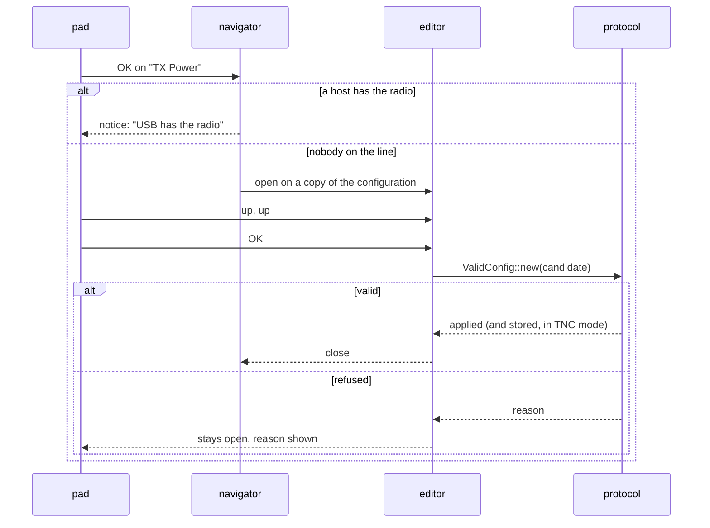

# The panel

The Super IO's 128 × 128 OLED and six-switch navigation pad give the board an
interface of its own. Five screens sit side by side (seven in an image with
the node); each has a menu of actions; the Radio screen's menu opens an
editor for every parameter a host can set; and in an image with the node, the
Messages screen opens the thread with each peer.

## Getting around

| Switch | On a screen | On Messages | In a thread | In a menu | In an editor |
|---|---|---|---|---|---|
| left / right | previous / next screen | previous / next screen | previous / next message | (ignored) | move the cursor (frequency only) |
| up / down | scroll the screen | move the highlight | scroll a line | move the highlight | step or change the value |
| OK | open the menu | open the thread | open the reply menu | pick the item | confirm |
| back | (nothing) | (nothing) | back to Messages | close the menu | cancel |

Held directions auto-repeat after 400 ms at eight steps a second. OK and back
do not repeat: an action chosen once is chosen once. A notice closes on any
key. The keyboard has keys of its own; see *Typing a message* below.

The bottom of every screen is a strip of icons, one a screen, saying where you are; the
top is a title bar with the screen's name, the battery percentage on the left
and the board's name on the right: the four hex digits that end the name it
advertises, so two boards on a table can be told apart. A screen with more lines
than fit shows a scrollbar. The panel goes to sleep after a minute without a
gesture, and the next gesture wakes it (and is otherwise swallowed).

## The screens

**Home.** Which host has the line (`USB`, `Bluetooth`, or `none`); in an image
with the node, whether the board is that host's `RNode`, a `node` of its own,
or neither for want of a stored configuration (`no radio config`; *Save
Config* on the Radio screen is the cure); while messages have arrived that
nobody has read, how many (`Unread 2`), a row that is there only then, so
Home scrolls by a line while it is; whether anything
has been said in the last ten seconds, what the radio is doing, packets in and
out, the last packet's RSSI and SNR, uptime, the battery, and what the charger
is doing (`charging`, `full`, `unplugged`, `fault`, `latched off`). The
battery reading is averaged over a few seconds and only moves when the cell
has, so it does not flicker between two numbers. Menu: *Sleep Screen*,
*Redraw*, and in an image with the node *Announce Now*, which announces the
board as soon as the announce budget allows (under a host it opens the same
notice a radio edit does).

**Messages**, in an image with the node only, next to Home. One line for
each peer the board has a conversation with, the one with the newest
message first: a `*` if something in it has not been read, the peer's name
(or the start of its address, as on Peers), and how long ago the last
message was. The highlighted line is knocked out of a bar; up and down move
it, and OK opens that peer's thread. With no conversations yet, the screen
says so and OK does nothing. Menu: none, since OK opens the thread.

**A thread** is the conversation with one peer, titled *Thread*, oldest at
the top and newest at the bottom. It opens at the first message not yet
read, or at the end if everything has been. Each message is a header line,
then its text wrapped to the width of the panel at word boundaries and at
its own line breaks, never cut off: a message longer than the screen is
scrolled through. A received message's header is the sender's name and its
age, and its text starts at the left edge. A sent one's header is `You`,
where it has got to (`queued`, `sent`, `delivered` or `failed`) and its age,
and its text is set in by two spaces, so the two are told apart by where
they stand. A sender whose key the board has not heard is marked
`(unverified sender)` under the header, and one whose key did not sign the
message `(bad signature)`. An attachment shows as `(attachment)`. Up and
down scroll a line; left and right jump to the previous or next message;
back returns to Messages on the line it was opened from. A message is read
once the lit panel has shown its last line, and Home's count and the `*`
on Messages follow. OK opens the reply menu.

**Replying.** The reply menu starts with *Type a Message*, which opens the
keyboard (below). Then come six lines that are sent as they read --
*OK*, *Yes*, *No*, *On my way*, *Can't talk now*, *Where are you?* -- then
*Send Position* and *Retry Failed*. Choosing a line sends it at once to the
peer whose conversation it is, and the thread moves to its end, where the
reply now is, `queued`. It becomes `sent` when it has gone on the air and
`delivered` when the recipient's proof comes back. A message the recipient
does not prove goes again, three times in all, and is then `failed (no proof
came back)`; one to a peer whose key the board has not heard is `queued
(finding a path)` while it asks, and `failed (no path found)` after a
minute. *Retry Failed* sends this conversation's failed messages again.
*Send Position* sends the GPS fix as `My position: 47.376887, 8.541694`,
with `(fix 12 min old)` after it if the receiver has lost the fix since; with
no fix at all it is not sent, and a notice says so. Under a host a reply is
written and kept, `queued (held for the host)`, and goes when the host has
gone; with no radio configuration stored it is `queued (no radio config)`.
Any key closes a notice.

**Typing a message.** The keyboard is a grid of keys under the text, in the
order of a QWERTY keyboard:

```text
1 2 3 4 5 6 7 8 9 0  Quit
q w e r t y u i o p  Send
a s d f g h j k l '  Space
z x c v b n m . , ?  Shift
```

| Switch | In the keyboard |
|---|---|
| up / down / left / right | move the highlight; it wraps at every edge |
| OK | type the highlighted key, or do what it says |
| back | delete the last character; with nothing typed, leave |

The highlight starts on `h`. *Shift* makes the next character a capital,
and turns the number row into `! # % ( ) * + - = /` and `'` into `:`, and
the grid shows what it will type while it is on. The line over the grid
counts against the limit, `35/287`. A message is one packet, so typing past
287 characters is refused (`No room`), not cut. *Send* writes the message
to the peer, closes the keyboard and shows it at the end of the thread. If
it cannot be written, the reason is shown where the text was, and the next
key brings the text back for another go. *Quit* leaves; with text typed it
asks first, and OK throws the text away while back keeps typing.

**Peers**, in an image with the node only, after Messages. Who else is
around: every Sideband, MeshChat or oxinode the board has heard announce an
LXMF address, the one heard most recently first. Two lines each: the name
from its announce and how long ago it was heard; then the signal of that
announce if it came straight off the air (`-69 dBm 11.2 dB`), or how many
hops it came if it was relayed (`2 hops`). A peer that announced no name
shows the start of its address in angle brackets, `<3b079e41d2>`, and a
character the font cannot draw shows as a box. The board keeps sixteen
peers, in RAM until a reboot; when a seventeenth is heard, the one heard
longest ago goes, unless every peer has sent the board a message, in which
case the newcomer is not kept. Menu: only *Back* for now. A conversation
starts when a peer writes first; writing to one from here is not there yet.

**A message arriving** lights the panel if it was out, and keeps it lit for
the same minute a press would. The first press after that acts as usual;
only a press made while the panel is out is taken as waking it. A thread
that is open when a message arrives shows it at the bottom.

The punctuation a phone types in place of plain ASCII is drawn as the ASCII
it stands for: curly quotes as `'`, dashes and the minus sign as `-`, an
ellipsis as `...`, and the no-break and thin spaces as spaces. Double quotes
of every kind are drawn as `'`, because the font has no `"`. Only the
drawing is folded; a name or a message is kept as it came. Anything else
outside the font is a box.

**Radio.** The band first (`sub-GHz` on the SMA or `2.4 GHz` on the u.FL,
decided by the frequency; a dash for a frequency in neither), then the
current configuration, which is exactly what a host reads back: frequency
(and the frequency the chip is actually tuned to after the reference
correction), bandwidth, spreading factor, coding rate, power, the bitrate
they come to, preamble, sync word, CRC, header mode, IQ. Then what the radio
is *doing* with it: `off`, `receiving`, `refused` with the reason, `failed`,
or `no radio`. Menu: *Band*, *Frequency*, *Bandwidth*, *Spread Factor*,
*Coding Rate*, *TX Power*, *Radio On/Off*, *Save Config*, *Reset Config* --
ten items with *Back*, one more than the panel holds, so the menu slides by
a row to reach the last.

**Bluetooth.** Absent, advertising or connected; the advertised name; the
passkey while a pairing is in progress; how many phones are bonded, out of
four. Menu: *Forget Phones*.

**Position.** The GPS receiver's state (`off`, `no data`, `searching`, `fix`),
satellites used and in view, the age of the last fix, UTC time and date,
latitude, longitude and altitude. While the receiver is off the screen says
what turns it on. Menu: *GPS On/Off*.

**System.** oxinode's version, the commit it was built from (a short hash,
`-dirty` if the tree had uncommitted changes), the RNode protocol version it
speaks, the device serial, the identity (`none`, `bad checksum`, `unsigned`,
`signed`), and free RAM. In an image with the node, also its LXMF address and
its Reticulum identity hash, each as two rows of sixteen hex digits: the
address is what a Sideband or MeshChat user sends to; and `Announce`, the
least time between two of its announces at the current configuration (`1 per
26 s`). Menu: *Reboot*, *Bootloader*.

Every field that can be unknown shows a dash. A board that has heard nothing
shows `RSSI -`, not `RSSI 0 dBm`; one with no cell shows `Battery -`; the
Position screen never shows `0.000000` as a claim to be in the Gulf of Guinea.

## Editing a setting

The first six items of the Radio menu open an editor over the screen.
Band, bandwidth, spreading factor, coding rate and power are steppers: up and down
move through a fixed set, saturating at the ends. Frequency is a digit editor,
`MMMM.kkk`, with left and right moving a cursor under one digit and up and
down changing it. Four megahertz digits, because 2478 MHz needs them; a
sub-GHz frequency shows a blank where its thousands digit would be, and the
cursor can sit there.

Confirming runs the candidate through the same validation a host's
configuration gets. A value the radio cannot do is **refused, not clamped**:
the editor stays open with the reason under the value, and nothing is applied.
Cancel leaves the previous value in place; nothing is applied until it is
confirmed.

The sets are wider than either band, on purpose. The bandwidth stepper holds
the ten LoRa bandwidths a host can name and the three the 2.4 GHz path has
(203.125, 406.25 and 812.5 kHz) in one ascending list, and the power stepper
runs from −18 to 22 dBm.

**Changing band** is the *Band* editor, not the frequency and then the
bandwidth. Each confirmation validates the whole configuration, so 2478 MHz
with the 125 kHz the board had is refused (*bandwidth belongs to the other
band*), and so is 406.25 kHz at 915 MHz; no order of one-field edits gets
across. The Band editor has two values, `sub-GHz, SMA` and `2.4 GHz, u.FL`,
and once the other is chosen it shows where the board will land:

| | sub-GHz | 2.4 GHz |
| --- | --- | --- |
| Frequency | 915.000 MHz | 2478.000 MHz |
| Bandwidth | 125 kHz | 406.25 kHz |
| Power | 14 dBm | 11 dBm |

Spreading factor, coding rate and everything else are kept. Confirming the
band the board is already on changes nothing, so a frequency picked on that
band stays. 406.25 kHz rather than the path's widest because carrier sense
at 812.5 kHz reads a quiet channel as busy
([#47](https://github.com/paulmeier/oxinode/issues/47)); the bandwidth
editor still reaches it. Like every edit, the switch is stored in TNC mode
and refused with the *Locked* notice while a host has the radio. **Move the
antenna** to the connector the editor names. The Radio screen's first row
says which band the board is on.



## Who owns the radio

An RNode is host-controlled. Reticulum configures the radio once when it brings
the interface up, validates what came back, and never looks again: a parameter
that changed underneath it afterwards is a debug line in its log and nothing
else. So the rule is:

> **A live session on USB or Bluetooth owns the live radio configuration.**

A live session is DTR asserted on the KISS port, or a phone connected. While
one is there, any action that would change the radio (an edit, *Radio
On/Off*, *Reset Config*) opens a notice saying which host has it and does
nothing else. A terminal left open on the KISS port counts as a host, and the
notice says so.

This is the panel's test, and it is stricter than the one that decides
whether an image with the node runs as a node: that needs a host to have
spoken, not just the port to be open. See
[The interface](../architecture/interface.md#two-modes-a-hosts-rnode-or-a-node-of-its-own).

With nobody on the line the panel is a controller, and the edit goes through
the same setters and validation a host gets. What the panel may do under a
host is what the host does not own: *Save Config* (store the live
configuration as the boot one, which is `CMD_CONF_SAVE` from the panel and
makes the board a TNC), *Forget Phones*, the screen, and the restarts.

## What survives a reboot

In TNC mode (a stored configuration exists) a confirmed edit goes into the
stored configuration as well as the live one, so it is what the board boots
with, and a reflash does not touch it. Under host control nothing is stored:
the host sets its configuration again on every connect, and a stored copy of a
panel edit would be a boot configuration nobody asked for.

The GPS receiver's on/off state is not stored. The mode switch is the
persistent default; a menu choice lasts until the next boot or the next move
of the switch. See [GPS](../hardware/gps.md).

## Looking at it without a board

Every screen, menu and editor renders on the host through the simulator, to a
PNG or in a terminal. See [The simulator](../development/simulator.md).
